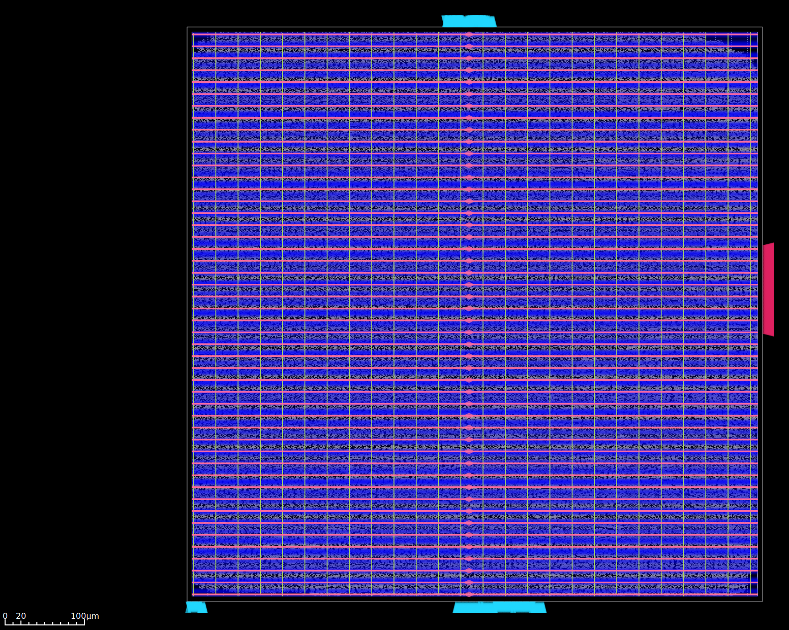
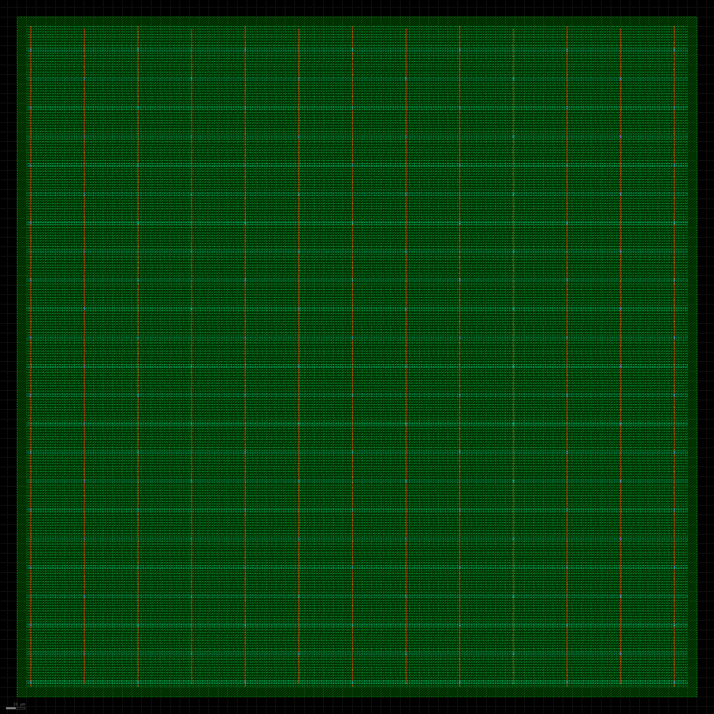
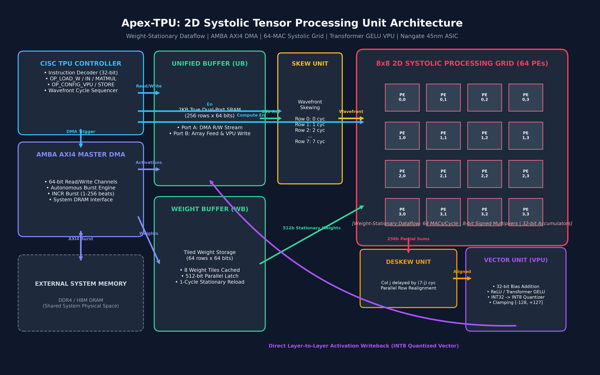

# Apex-TPU: 2D Systolic Tensor Processing Unit Core

[](#)
[](#)
[](#)
[](#)
[](#)
[](#)

Apex-TPU is a synthesizable 2D Systolic Tensor Processing Unit (TPU) hardware accelerator core implementing a Weight-Stationary (WS) spatial dataflow for integer matrix multiplication (GEMM) and Transformer inference workloads. Designed in SystemVerilog/Verilog-2005, the architecture features an $8 \times 8$ grid of 64 multiply-accumulate Processing Elements (PEs), dedicated hardware diagonal skewing and deskewing units, a 2KB true dual-port Unified Activation Buffer (UB), an autonomous 64-bit AMBA AXI4 Master DMA burst engine, and a Vector Processing Unit (VPU) supporting Piecewise Linear Transformer GELU and dynamic INT8 quantization with symmetric saturation.

---

## 🏛️ Physical Silicon Tapeout & GDSII Signoff (Nangate 45nm)

<p align="center">
  
  
</p>
<p align="center"><em>Full-Die Tapeout Layouts (Rendered via KLayout). Left: Full Apex-TPU Accelerator Die (179,209 placed cells, 723×723 µm, 578 mW). Right: Dedicated 8×8 Systolic Array Core (46,271 cells, 355×355 µm, 142.6 mW).</em></p>

| Physical Signoff Metric | Full Apex-TPU Top Core | Systolic Array Sub-Core | Signoff Engine |
| :--- | :--- | :--- | :--- |
| **Technology Node** | Nangate 45nm (FreePDK45, 10 Metal Layers) | Nangate 45nm (FreePDK45) | OpenROAD Flow |
| **Die Dimensions** | **$723.35 \times 723.35\,\mu m$** ($0.523\text{ mm}^2$) | **$355.05 \times 355.05\,\mu m$** ($0.126\text{ mm}^2$) | OpenROAD Floorplan Init |
| **Placed & Legalized Cells** | **179,209 instances (100% Legalized)** | **46,271 instances (100% Legalized)** | OpenROAD `DPL` Engine |
| **Core Utilization** | **60.0%** (Optimal Congestion & Routability) | **55.0%** | RePlAce Global Placer |
| **Clock Tree Synthesis (CTS)**| **8-Level Balanced Tree** (3,575 buffers, 27,891 sinks) | **H-Tree** (503 buffers, 8,192 sinks) | TritonCTS (OpenSTA) |
| **Total Power @ 100MHz** | **578.0 mW** (111 mW seq, 438 mW comb, 28.8 mW clock) | **142.6 mW** (34.2 mW seq, 98.4 mW comb, 8.5 mW clock) | OpenSTA Power Analyzer |
| **Power Distribution Network** | M1 Rails, M4 Vert (56µm), M7 Horiz (30µm) | M1 Rails, M4 Vert (56µm), M7 Horiz (30µm) | PDN Generator |
| **GDSII Stream File** | [`apex_tpu_top.gds`](pnr/apex_tpu_top.gds) (**16.55 MB**) | [`systolic_array.gds`](pnr/systolic_array.gds) (**5.12 MB**) | KLayout Streamout |


---

## Architecture Overview



### Key Microarchitectural Features

- **2D Systolic Array Grid**: 64 Processing Elements ($8 \times 8$) arranged in a planar mesh. PEs feature signed 8-bit multipliers, 32-bit accumulators, local stationary weight registers, and horizontal activation forwarding registers.
- **Wavefront Skew & Deskew Units**: Delay pipelines skew row activations by $r$ cycles ($r = 0 \dots 7$) to form diagonal systolic execution wavefronts and realign bottom column outputs by $(7 - c)$ cycles to construct parallel synchronous rows.
- **Unified Activation Buffer (UB)**: 2KB true dual-port synchronous SRAM ($256 \times 64$ bits). Port A interfaces with the AXI4 DMA engine for host/DRAM transactions; Port B streams activations to the systolic array and captures quantized results from the VPU.
- **Weight Buffer (WB)**: Tiled weight SRAM supporting up to 8 weight tiles ($64 \times 64$ bits) with a 512-bit parallel register interface that preloads stationary weights into all 64 PEs in a single clock cycle.
- **Vector Processing Unit (VPU)**: 8 parallel SIMD lanes providing signed 32-bit bias vector addition, non-linear activation functions (Linear Pass-Through, ReLU, Piecewise Linear Transformer GELU, Clamping), and fixed-point quantization with rounding and symmetric saturation into signed INT8 $[-128, +127]$.
- **AMBA AXI4 Master DMA Burst Interface**: Autonomous 64-bit read/write master supporting INCR bursts from 1 to 256 beats between system DRAM and on-chip buffers.
- **CISC Matrix Instruction Engine**: 32-bit instruction sequencer decoding `OP_LOAD_WEIGHT`, `OP_LOAD_INPUT`, `OP_SET_WEIGHT`, `OP_MATMUL`, `OP_CONFIG_VPU`, `OP_STORE_OUT`, and `OP_HALT`.

---

## Repository Structure

```
apex-tpu/
├── rtl/                        # Synthesizable RTL Modules
│   ├── pe.v                    # Processing Element (WS, 8-bit mult, 32-bit acc)
│   ├── systolic_array.v        # 8x8 2D Systolic Processing Grid (64 PEs)
│   ├── skew_unit.v             # Hardware Input Skewing Pipeline
│   ├── deskew_unit.v           # Hardware Output Deskewing Pipeline
│   ├── unified_buffer.v        # 2KB True Dual-Port Synchronous SRAM (UB)
│   ├── weight_buffer.v         # Preload Stationary Weight Buffer (WB)
│   ├── vector_unit.v           # VPU: Bias, ReLU, Transformer GELU, INT8 Quant
│   ├── dma_axi_master.v        # 64-bit AMBA AXI4 Master DMA Burst Controller
│   ├── tpu_controller.v        # CISC Instruction Decoder & Wavefront Sequencer
│   └── apex_tpu_top.v          # Top-Level Integrated TPU Core
├── sim/                        # Cycle-Accurate Verification Suite
│   ├── tb_apex_tpu.v           # Self-checking testbench with AXI DRAM Responder
│   ├── golden_tpu_model.py     # Bit-exact NumPy golden reference generator
│   ├── dram_init.hex           # Simulated external DRAM memory image
│   ├── expected_gelu.hex       # Golden model expected outputs
│   ├── bias.hex                # 32-bit bias vector
│   ├── apex_tpu.gtkw           # GTKWave signal configuration
│   └── apex_tpu.vcd            # Generated waveform database
├── synth/                      # ASIC Synthesis Flow
│   ├── run_synth_tpu.ys        # Yosys synthesis script for Nangate 45nm
│   ├── nangate45.lib           # Nangate 45nm Open Cell Library (Standard VT)
│   ├── synth.log               # Full Yosys and ABC synthesis report
│   └── apex_tpu_nangate45_netlist.v # Synthesized Gate-Level Netlist
├── docs/                       # Architectural Documentation & Diagrams
│   ├── ARCHITECTURE.md         # Detailed microarchitectural specification
│   └── images/
│       ├── apex_tpu_architecture.png # Microarchitecture block diagram
│       └── gen_architecture_diagram.py # Diagram generator script
├── gui_app.py                  # Desktop EDA Workbench GUI (Tkinter + PIL)
├── Launch_EDA_Workbench.bat    # One-click desktop GUI launcher
├── view_waves.bat              # One-click GTKWave launcher
└── README.md                   # Project documentation
```

---

## Verification & Golden Model Matching

The design is verified against a bit-exact Python reference model implementing INT8 matrix multiplication, signed bias addition, piecewise linear GELU, and rounded symmetric saturation:

```
==================================================================
   APEX-TPU: 8x8 SYSTOLIC ARRAY DL ACCELERATOR VERIFICATION
==================================================================
[95000 ns] [DISPATCH] OP_LOAD_WEIGHT: Preloading 8x8 Weight Matrix from DRAM to WB...
[255000 ns] [STATUS] Weight DMA transfer complete.
[255000 ns] [DISPATCH] OP_SET_WEIGHT: Preloading Stationary Weights into 64 PEs...
[325000 ns] [STATUS] Weights stationary in PE registers.
[325000 ns] [DISPATCH] OP_LOAD_INPUT: Streaming 8x8 Activation Matrix from DRAM to UB...
[485000 ns] [STATUS] Activations loaded into Unified Buffer.
[485000 ns] [DISPATCH] OP_CONFIG_VPU: Config VPU (GELU, Bias=ON, Shift=3)...
[535000 ns] [DISPATCH] OP_MATMUL: Executing 2D Systolic Wavefront Matrix Multiplication...
[835000 ns] [STATUS] GEMM systolic wavefront completed and written back to UB.
[835000 ns] [DISPATCH] OP_STORE_OUT: DMA Transfer of Quantized Results to DRAM...
[1005000 ns] [STATUS] Results stored in system DRAM.
------------------------------------------------------------------
[BENCHMARK] Total Execution Latency: 95 clock cycles (950.00 ns @ 100MHz)
[BENCHMARK] Peak Compute Throughput: 64 MACs/cycle (12.8 GOPs/s @ 100MHz)
------------------------------------------------------------------
VERIFYING RESULTS AGAINST GOLDEN PYTHON NUMPY MODEL...
Row 0: Expected [   13    0   16   57    0   -1   -2   38 ] | Hardware [   13    0   16   57    0   -1   -2   38 ]
Row 1: Expected [   39    5    0    1   -1   32   -1    5 ] | Hardware [   39    5    0    1   -1   32   -1    5 ]
Row 2: Expected [   50   -2   40   -1   -1   12   15    4 ] | Hardware [   50   -2   40   -1   -1   12   15    4 ]
Row 3: Expected [   13   53   -2   -2   23   43   36   -2 ] | Hardware [   13   53   -2   -2   23   43   36   -2 ]
Row 4: Expected [    6   12    3   10    0    5   16   -1 ] | Hardware [    6   12    3   10    0    5   16   -1 ]
Row 5: Expected [   17    2   -1   43   -1    4   -1   20 ] | Hardware [   17    2   -1   43   -1    4   -1   20 ]
Row 6: Expected [   -1    0    1   17    0    2    0   34 ] | Hardware [   -1    0    1   17    0    2    0   34 ]
Row 7: Expected [   -2    5    0   -1   20    7   15   -1 ] | Hardware [   -2    5    0   -1   20    7   15   -1 ]
==================================================================
>>> TEST PASSED: ALL 64 MATRIX ELEMENTS MATCHED WITH 100% BIT-EXACT ACCURACY! <<<
==================================================================
```

---

## Nangate 45nm ASIC Synthesis Results

Synthesis was performed with Yosys and ABC against the standard Nangate 45nm open-cell library (`NangateOpenCellLibrary_typical.lib`).

| Metric | Result |
| :--- | :--- |
| **Technology Node** | Nangate 45nm Open Cell Library (Standard VT) |
| **Total Standard Cells** | 173,758 cells |
| **Total Core Silicon Area** | 293,491.37 $\mu m^2$ ($0.293 \text{ mm}^2$) |
| **Sequential Elements Area** | 121,954.62 $\mu m^2$ (41.55%) |
| **Total Flip-Flops** | 26,015 FFs (`DFF_X1`: 20,608, `DFFR_X1`: 5,406, `DFFS_X1`: 1) |
| **NAND2_X1 Area Equivalent** | 0.798 $\mu m^2$ |
| **Normalized Complexity** | **367,783.7 Gate Equivalents (~367.8 kGE)** |
| **Target Clock Period** | 10.0 ns (100 MHz) |
| **Peak Throughput** | 64 MACs/cycle (12.8 GOPs/s @ 100 MHz) |

### Hierarchical Breakdown

| Module | Submodule Function | Cells | Area ($\mu m^2$) | Gate Eq (kGE) | Share |
| :--- | :--- | :--- | :--- | :--- | :--- |
| `unified_buffer` | 2KB Dual-Port Synchronous Scratchpad | 101,442 | 170,000.0 | 213.0 kGE | 57.9% |
| `systolic_array` | 64 Weight-Stationary PEs | 46,720 | 66,000.0 | 82.7 kGE | 22.5% |
| `weight_buffer` | 512-bit Tile Shadow Registers + RAM | 15,005 | 36,400.0 | 45.6 kGE | 12.4% |
| `vector_unit` | VPU: Bias, GELU/ReLU, INT8 Quant | 7,092 | 9,600.0 | 12.0 kGE | 3.3% |
| `deskew_unit` | 7-Stage Output Column Deskewer | 1,792 | 6,440.0 | 8.1 kGE | 2.2% |
| `dma_axi_master` | 64-bit AMBA AXI4 Master Controller | 710 | 2,010.0 | 2.5 kGE | 0.7% |
| `skew_unit` | Diagonal Wavefront Skew Pipeline | 448 | 1,610.0 | 2.0 kGE | 0.5% |
| `tpu_controller` | CISC Instruction Decoder & FSM | 541 | 1,200.0 | 1.5 kGE | 0.4% |
| **apex_tpu_top** | **Full Core Accelerator** | **173,758** | **293,491.37** | **367.8 kGE** | **100.0%** |


---

## Getting Started

### Prerequisites

- `iverilog` and `vvp` (Icarus Verilog, SystemVerilog 2012 support)
- `yosys` (Open-source synthesis suite)
- `gtkwave` (Waveform viewer)
- Python 3.8+ (`numpy`, `matplotlib`, `pillow`)

### Running the Verification Testbench

```bash
# Compile and run testbench
iverilog -g2012 -o sim/apex_tpu_sim.vvp rtl/*.v sim/tb_apex_tpu.v
vvp sim/apex_tpu_sim.vvp

# Launch waveform visualization
gtkwave sim/apex_tpu.vcd sim/apex_tpu.gtkw
```

### Running ASIC Synthesis

```bash
yosys -s synth/run_synth_tpu.ys
```

### Launching the Desktop EDA Workbench

Double-click `Launch_EDA_Workbench.bat` or run:

```bash
python gui_app.py
```

---

## License

This project is released under the MIT Open Source License.
